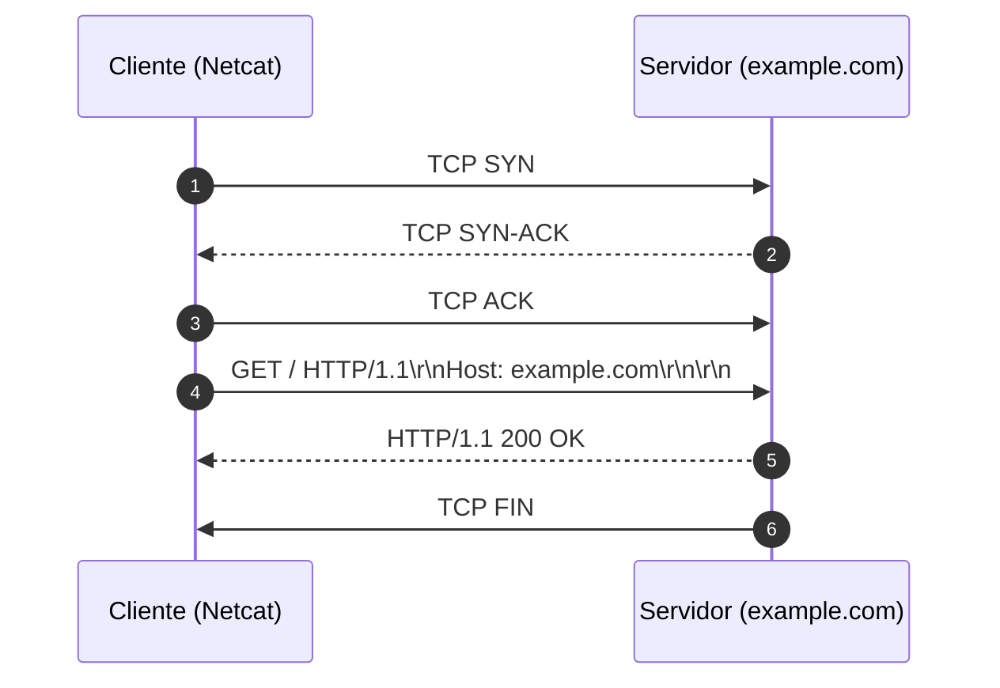

# Memória de Desenvolvimento — Semana 01
**Aluno:** João Pedro Ribeiro Manhães  
**Curso:**  Engenharia da Computação  

---

## 1. Mapeamento da Camada de Transporte
Diagrama Mermaid demonstrando o ciclo de vida da requisição executada no laboratório:

---

## 2. Captura Bruta e Análise do Protocolo
* **Comando Utilizado:** `nc -C example.com 80`
* **Status Line Retornada:** `HTTP/1.1 200 OK`

### Análise dos Headers Recebidos:
1. **`Content-Type`:** Fala ao cliente basicamente o tipo de arquivo retornado. É importante para que o navegador, ou programa, saiba como ler os dados recebidos.é renderizado em HTML  e codificado em utf-8
2. **`Content-Length`:** Esse header indica como o tamanho do conteúdo da resposta é informado. O Content-Length mostra o tamanho total da resposta em bytes. Já o Transfer-Encoding: chunked permite que o servidor envie os dados em partes, sem precisar saber o tamanho total antes. No final, o servidor envia um bloco de tamanho zero (0\r\n\r\n), indicando que terminou de enviar os dados.
3. **`Connection: close`:** O connection: close indica que a conexão será fechada após o envio da resposta do servidor. O keep-alive permite manter a conexão aberta para utilizar ela novamente em outras requisições.

---

## 3. Conclusão Técnica
Aprendi que o HTTP funciona como uma espécie de comunicação entre cliente e servidor e que funciona por meio da comunicação TCP,  e que os dados transmitidos nessa comunicação  são em sequencia de bytes, seguindo uma estrutura desse protocolo.Os cabeçalhos são organizados usando CRLF (\r\n) para separar as linhas, enquanto uma linha em branco (\r\n\r\n) indica o fim dos cabeçalhos e o início do corpo da mensagem. Entender esse funcionamento ajuda a compreender como as requisições e respostas são organizadas e interpretadas durante a comunicação na web.

