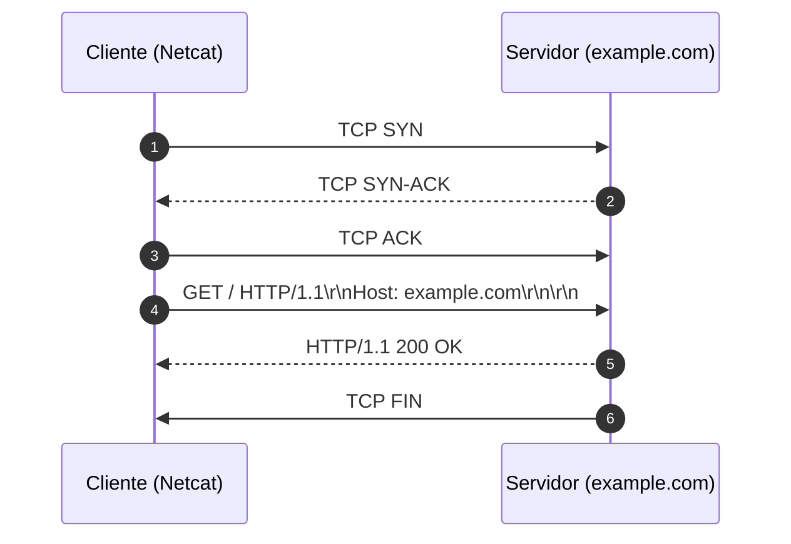

# Memória de Desenvolvimento — Semana 01
**Aluno:** João Pero Ribeiro Manhães  
**Curso:**  Engenharia da Computação  

---

## 1. Mapeamento da Camada de Transporte
Diagrama Mermaid demonstrando o ciclo de vida da requisição executada no laboratório:

---

## 2. Captura Bruta e Análise do Protocolo
* **Comando Utilizado:** `nc -C example.com 80`
* **Status Line Retornada:** `HTTP/1.1 200 OK`

### Análise dos Headers Recebidos:
1. **`Content-Type`:** [Explique qual o MIME type retornado e a importância para o parser]
2. **`Content-Length`:** [Explique como este cabeçalho delimita o tamanho do payload sobre a stream TCP]
3. **`Connection: close`:** [Explique a diferença entre fechar o socket imediatamente vs keep-alive]

---

## 3. Conclusão Técnica
[Descreva em 1 parágrafo a importância de compreender o HTTP como uma transmissão de bytes ASCII delimitada por CRLF em vez de um arquivo estático local.]
